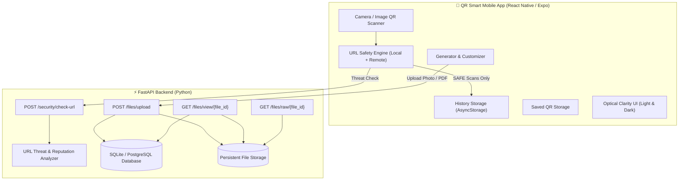

# QR Smart – Advanced QR & Barcode Ecosystem 📱🛡️⚡

[](https://reactnative.dev/)
[](https://expo.dev/)
[](https://www.typescriptlang.org/)
[](https://fastapi.tiangolo.com/)
[](https://www.python.org/)
[](https://www.sqlite.org/)
[](LICENSE)

**QR Smart** is a production-grade, privacy-first mobile application and backend ecosystem engineered for high-performance QR code and barcode scanning, rich multi-format generation, cloud-linked photo and PDF QR creation, and real-time **URL Safety / Malicious Link Protection**.

---

## 🌟 Key Features

### 🛡️ 1. URL Safety & Malicious Link Protection Engine
- **No Auto-Opening**: Protects users by intercepting all scanned URLs before launching browsers.
- **Multi-Stage Threat Scoring (0–100 Risk Index)**:
  - **Dangerous Scheme Blocking**: Intercepts and blocks `javascript:`, `data:`, `file:`, `content:`, `intent:`, `vbscript:`, and `blob:`.
  - **Punycode & Homograph Detection**: Flags deceptive Unicode / `xn--` spoofing of major brands (Google, Apple, PayPal, Microsoft, etc.).
  - **Raw IP Address & Port Inspection**: Flags raw IPv4/IPv6 hosts, octal/hex IP evasion, and non-standard high-risk ports (`:1337`, `:6667`, `:8080`, etc.).
  - **Deceptive Authority & Credential Detection**: Catches `@` symbol tricks (e.g. `https://google.com@phishing.com`).
  - **Malicious File Extensions**: Detects direct executable download links (`.apk`, `.exe`, `.scr`, `.bat`, etc.).
  - **URL Shortener & High-Abuse TLD Auditing**: Flags masked destinations (`bit.ly`, `tinyurl.com`) and suspicious top-level domains.
  - **Insecure HTTP Warnings**: Flags unencrypted HTTP endpoints.
- **Classification States & Action UI**:
  - `SAFE`: Verified green badge, domain inspection, full URL copy, and safe manual opening. Saved to history.
  - `SUSPICIOUS`: Amber caution warning with risk reasons. **Not saved to history.**
  - `UNSAFE`: Full red danger alert, threat breakdown, primary "Go Back" action, and secondary "Open Anyway" with an explicit confirmation dialog. **Not saved to history or Last Scanned.**
  - `UNKNOWN`: Offline / unreachable fallback caution state. **Not saved to history.**
- **5-Minute Client-Side Cache**: Prevents duplicate network requests.

---

### 📷 2. Photo QR & Supabase Cloud Storage
- Pick any image from your gallery (`JPG`, `JPEG`, `PNG`, `WEBP`, max 10 MB).
- Uploads directly to **Supabase Storage** bucket (`qr-files/photos/...`) via server-side service credentials.
- Generates a random unique ID (e.g., `P-X82KM91P`) and a shareable public HTTPS URL.
- When scanned from any other phone, the high-resolution photo opens immediately in browser or image viewer (no localhost dependency).

---

### 📄 3. PDF & Document QR (Supabase Storage)
- Upload any PDF document (`application/pdf`, max 25 MB) from device storage.
- Uploads to **Supabase Storage** bucket (`qr-files/pdfs/...`) with metadata tracking.
- Generates a permanent public HTTPS URL encoded into the QR code.
- Scanners on other phones open and render the PDF document directly.

---

### 📊 4. 1D & 2D Barcode Generator
- Generate standard industrial and retail barcodes:
  - **CODE128** (Universal alphanumeric)
  - **EAN-13** (Global trade items)
  - **UPC-A** (North American retail products)
  - **CODE39** (Industrial & inventory)
  - **ITF-14** (Packaging & shipping containers)
- Real-time SVG barcode rendering with checksum validation and high-resolution export.

---

### 🎨 5. Multi-Format QR Generator & Customizer
- **Supported Formats**: Website URL, Wi-Fi Network (WPA/WEP/Open with hidden SSID support), Contact Card (vCard 3.0), Plain Text, Phone Call, SMS, Email, Geo Location (Maps), Photo QR, and PDF Document QR.
- **Visual Customizer**: Foreground/background color palettes, error correction levels (`L`, `M`, `Q`, `H`), custom size scaling, and center logo embedding.

---

### 🧭 6. Modern Navigation & WhatsApp-Style Header
- **Center Floating QR Scan Button**: Prominent primary button with smooth touch targets and tactile haptic feedback.
- **WhatsApp-Style Header**: Clean, standalone Bell notification icon and Plus (`+`) button.
- **Quick-Create Bottom Sheet Modal**: 1-tap launcher for QR Code, Photo QR, PDF QR, and Barcode.

---

### 📜 7. Scan History & Selection Mode
- **Real-Time Search**: Search through scan history by domain, URL, Wi-Fi SSID, contact name, or raw text.
- **Type Filters**: Filter by `All`, `URL`, `Wi-Fi`, `Text`, `Contact`, `Phone`, `Email`, `SMS`, `Location`, or `Barcode`.
- **Long-Press Multi-Select**: Enter batch selection mode with single-tap item toggle and batch delete.
- **Verified Safe Badges**: Displays a verified shield badge on clean URL scans.

---

## 🏛️ System Architecture



---

## 📁 Repository Structure

```
QR-scanner-app/
├── frontend/                     # React Native + Expo Mobile Application
│   ├── src/
│   │   ├── api/                  # Auto-discovery API client (client.ts)
│   │   ├── components/           # UI Components (URLSafetyCard, HistoryCard, ResultCard...)
│   │   ├── constants/            # Configuration & QR type definitions (config.ts)
│   │   ├── navigation/           # Stack & Bottom Tab Navigators
│   │   ├── screens/              # HomeScreen, ScannerScreen, ScanResultScreen, HistoryScreen...
│   │   ├── services/             # File upload service (fileUploadService.ts)
│   │   ├── storage/              # Offline local storage (history, saved QRs, settings...)
│   │   ├── theme/                # Theme context, colors, typography tokens
│   │   ├── types/                # TypeScript schemas (qr.ts, navigation.ts...)
│   │   └── utils/                # URL safety analyzer, barcode encoder, QR parser...
│   ├── package.json
│   └── app.json
│
└── backend/                      # Python FastAPI REST API
    ├── app/
    │   ├── api/v1/endpoints/     # Security, Files, Scans, Saved QRs, Health
    │   ├── core/                 # Config & CORS settings
    │   ├── database/             # SQLAlchemy engine & SQLite session
    │   ├── models/               # StoredFile, SavedQR, Scan models
    │   ├── schemas/              # Pydantic v2 schemas (url_safety, stored_file...)
    │   ├── services/             # Threat scoring, URL analysis & file managers
    │   ├── uploads/              # Local disk storage for uploaded photos/PDFs
    │   └── main.py               # Application entry point & router mounting
    └── requirements.txt
```

---

## 🚀 Getting Started

### Prerequisites
- **Node.js** 18+ and **npm** / **yarn**
- **Python** 3.10+
- **Expo Go** app on your physical mobile device, or Android Studio / Xcode simulator

---

### 1. Backend Setup (FastAPI)

```bash
cd backend

# Create virtual environment (optional)
python -m venv venv
# Windows:
.\venv\Scripts\activate
# macOS/Linux:
source venv/bin/activate

# Install dependencies
pip install -r requirements.txt

# Start FastAPI server on port 8000
python -m uvicorn app.main:app --host 0.0.0.0 --port 8000 --reload
```

- **Interactive API Documentation (Swagger)**: `http://localhost:8000/docs`
- **Health Check**: `http://localhost:8000/health`

---

### 2. Frontend Setup (Expo / React Native)

```bash
cd frontend

# Install dependencies
npm install

# Start Metro Bundler
npx expo start
```

- If testing on a physical Android device via USB, route port 8000:
  ```bash
  adb reverse tcp:8000 tcp:8000
  ```
- Scan the QR code displayed in the terminal using the **Expo Go** app.

---

## 📡 API Reference

| Method | Endpoint | Description |
| :--- | :--- | :--- |
| `GET` | `/health` | Server health check and uptime status |
| `POST` | `/security/check-url` | Analyze URL for malicious threats and return safety score |
| `POST` | `/files/upload` | Upload photo or PDF document for QR cloud storage |
| `GET` | `/files/view/{file_id}` | Web viewer for uploaded photo / PDF document |
| `GET` | `/files/raw/{file_id}` | Raw file binary stream (download / preview) |
| `GET` | `/api/v1/scans` | List scan history (cloud sync) |
| `POST` | `/api/v1/scans` | Record a new scan entry |
| `GET` | `/api/v1/qr/saved` | List saved favorite QR codes |
| `POST` | `/api/v1/qr/saved` | Save a new custom QR code |

---

## 🧪 Automated Testing

Run the URL safety threat verification suite:

```bash
cd backend
python -c "
import sys; sys.path.insert(0, '.');
from app.services.url_safety_service import URLSafetyService
print(URLSafetyService.analyze_url('https://google.com'))
"
```

To run frontend TypeScript validation:
```bash
cd frontend
npx tsc --noEmit
```

---

## 📄 License

This project is licensed under the MIT License - see the [LICENSE](LICENSE) file for details.
